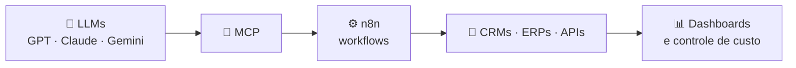

 

---

## 👋 Oi, eu sou o Rodrigo

Construo soluções de IA de ponta a ponta para resolver **problemas reais de negócio**: agentes autônomos, automações e integrações entre LLMs e sistemas corporativos (CRMs, ERPs, APIs).

> 🏢 **Tech Lead na DigiEnge** — crio os "Funcionários de IA" do SaaS **SuperFuncionário**, coordeno prompters e desenvolvo automações e integrações.
>
> 🎓 **Análise e Desenvolvimento de Sistemas** na Estácio — conclusão prevista para o 2º semestre de 2027.

---

## 🧠 O que eu faço no dia a dia

<table>
<tr>
<td width="50%" valign="top">

### 🤖 Agentes de IA
Orquestração de agentes com **GPT (OpenAI)**, **Claude** e **Gemini**, prompt engineering avançado e **RAG**.

</td>
<td width="50%" valign="top">

### ⚙️ Automação
Workflows avançados no **n8n**, com APIs REST e scripts em **Python**. Também uso **Make** e **Zapier**.

</td>
</tr>
<tr>
<td width="50%" valign="top">

### 🔌 Integrações
Servidores **MCP** (Model Context Protocol), APIs em **JavaScript** e **Supabase/PostgreSQL** com **Docker**.

</td>
<td width="50%" valign="top">

### 📊 Dados com IA
Dashboards no **Looker Studio** e controle de custo de consumo de API.

</td>
</tr>
</table>

⚡ **Vibe coding:** uso **Cursor** e **Replit** para sair da ideia ao produto rápido.

---

## 🔗 Como as peças se conectam

---

## 🚀 Projetos em destaque

<table>
<tr>
<td width="33%" valign="top">

### 🌉 mcp-n8n-bridge
Servidor MCP que conecta **agentes de IA** a **workflows do n8n**.

</td>
<td width="33%" valign="top">

### 📅 Intermitente-PRO
Plataforma **full-stack** para gestão de vagas de trabalho intermitente.

</td>
<td width="33%" valign="top">

### 💬 Tratamento-WhatsApp-Brasil
Ferramenta que padroniza contatos de um **CSV** para o formato do WhatsApp.

</td>
</tr>
</table>

---

## 🧰 Stack

**IA e automação**

**Desenvolvimento**

**Dados e infra**

**Ferramentas**

---

## 📊 GitHub

---

## 📬 Vamos conversar?

Se você tem um processo repetitivo, um sistema que precisa "conversar" com uma IA ou uma ideia de agente para tirar do papel, é só chamar.

